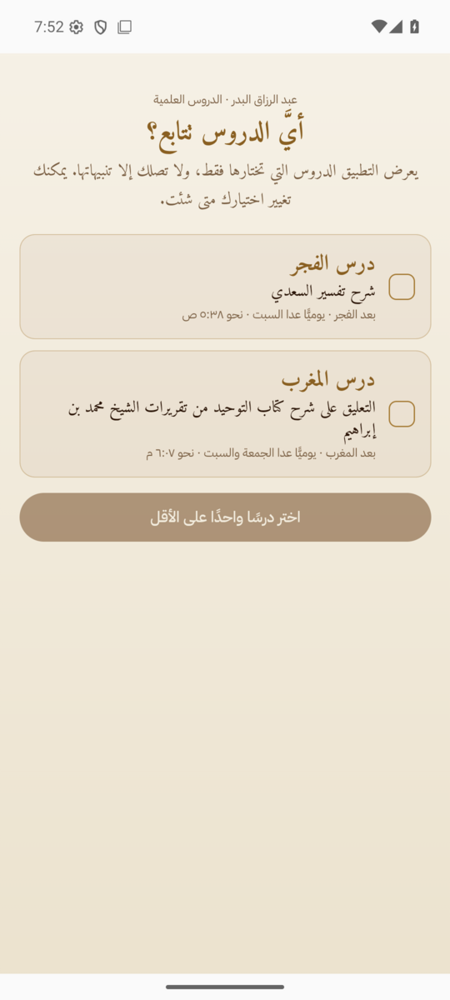
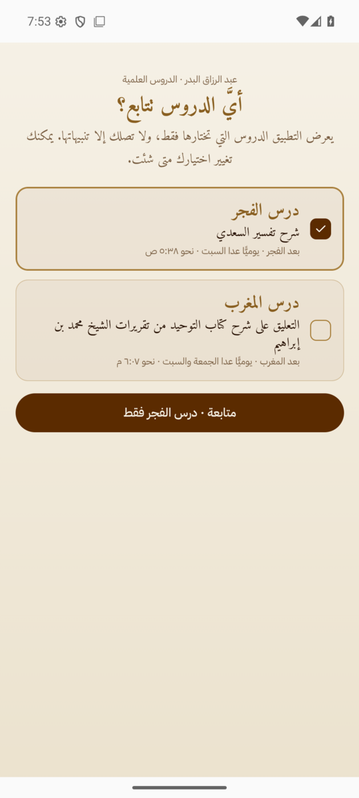
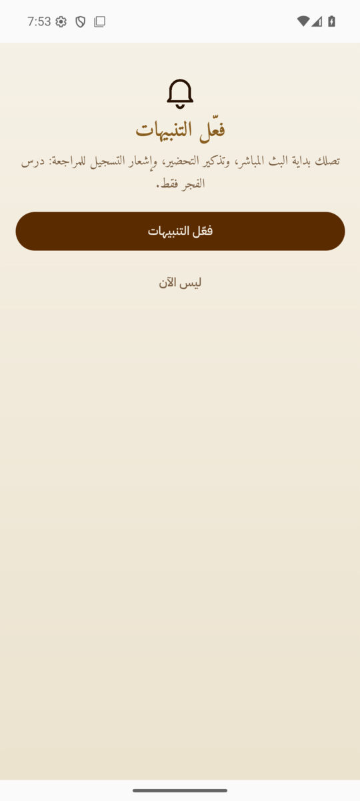
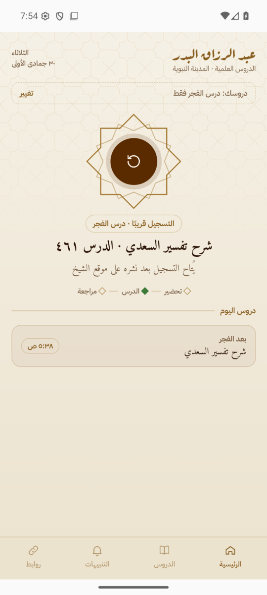
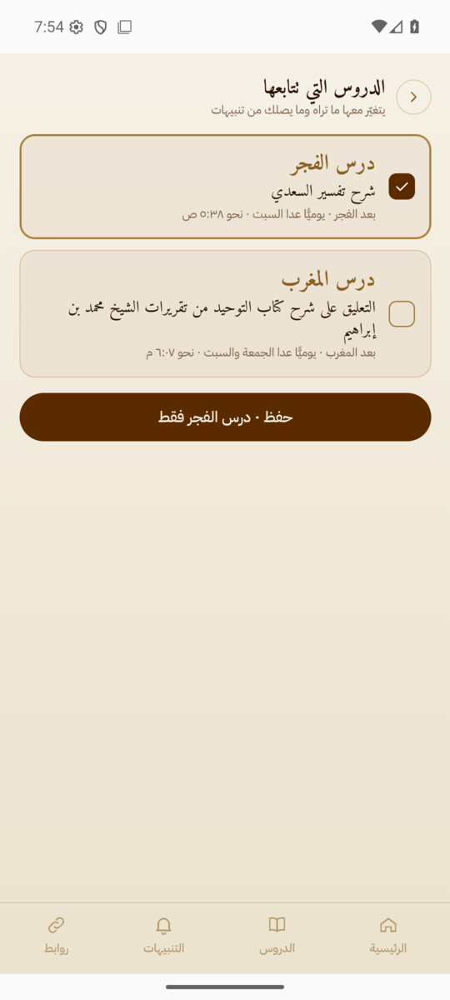
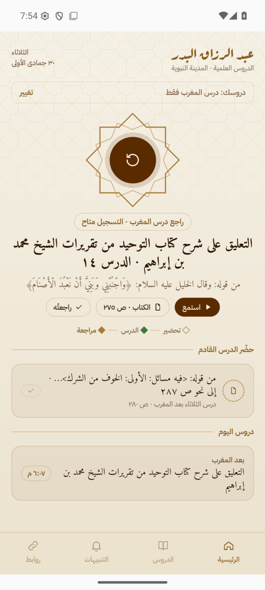
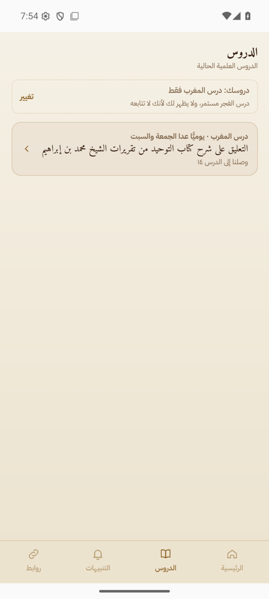
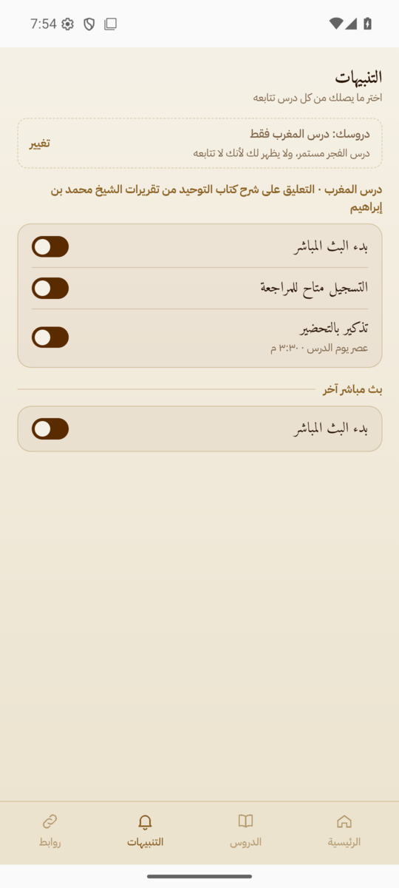
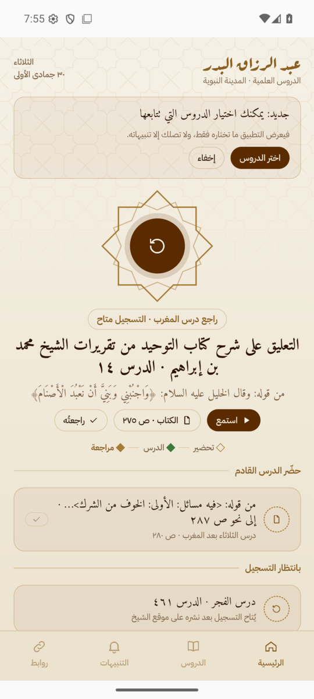

# Choosing the lessons you follow

Listeners pick the courses they follow (today: Fajr · Tafsir as-Sa'di, Maghrib · Kitab at-Tawhid). The app then shows only those courses and sends only their notifications. The course list comes from `/api/state`, so a third course needs no app change.

## One model

The single source of truth is the stored `follow` record (pure logic in `app/src/logic/follow.ts`, storage in `app/src/follow.ts`):

- `ids`: the courses the listener follows. A followed course that drops out of the list for a while stays here, so it comes back followed;
- `known`: every course id that existed when the record was last reconciled;
- `fresh`: courses that appeared later and were *not* followed automatically (see below);
- `hint`: an existing user who has not seen the choice yet.

`filterState(state, follow)` removes the other courses from the state, and clears `live` when the broadcast belongs to an unfollowed course. Home, the Courses tab, a course page, the book, push routing and the topic sync all read the filtered state, so nothing can leak through a screen that forgot to filter.

Notifications have one model, not two. Following a course is the outer switch; the three per-course switches on the Notifications screen are details *inside* a followed course:

- **Drop a course:** its three topics are unsubscribed and forgotten.
- **Add it back:** its three topics come back on (topics are on by default once permission is granted).
- **Notifications screen:** it lists only followed courses, with a line on top naming them and a «تغيير» link to the chooser.

## Options considered for where the switch lives

**A. Settings-style row only (Courses tab).** Easy to build, easy to miss. A one-course user never visits it and cannot tell why the other course is gone.

**B. A status line under the Home header, plus the same line on Courses and Notifications (chosen).** The line appears only while something is hidden, names what is shown, says the rest still runs, and opens the chooser:

```
┌──────────────────────────────┐
│ عبد الرزاق البدر       الاثنين │
│ يظهر لك درس الفجر فقط · تغيير  │  ← only when filtered
│        ( hero )               │
└──────────────────────────────┘
```

**C. A segmented control on Home (الفجر | المغرب | الكل).** Fast to switch, but it reads as a view filter, not a commitment, so it would not carry notifications along. It also does not scale past two courses.

B wins because the filter is visible exactly where content is missing. Its wording («درس المغرب مستمر» on the Courses tab) prevents the "was it cancelled?" reading, and it costs one line of space.

## First launch

```
┌──────────────────────────────┐   ┌──────────────────────────────┐
│ أيَّ الدروس تتابع؟             │   │ فعّل التنبيهات                 │
│ [✓] درس الفجر                 │   │ تصلك بداية البث وتذكير التحضير │
│     شرح تفسير السعدي · يوميًّا… │──▶│ لدرس الفجر فقط                 │
│ [ ] درس المغرب                │   │ ( فعّل التنبيهات )  ليس الآن   │
│ ( متابعة · درس الفجر فقط )     │   └──────────────────────────────┘
└──────────────────────────────┘
```

- **The chooser:** nothing is preselected. The slot is the largest text, since it is what tells the cards apart, and the button names the result: «درس الفجر فقط», «درس المغرب فقط», «الدرسان كلاهما». With no course picked, the button is disabled and reads «اختر درسًا واحدًا على الأقل».
- **The notification step:** it replaces the cold system prompt at launch (backlog N1, decision Q6). It shows only on a native build while permission is still `prompt`. Topics are subscribed whether or not the listener grants, so a later grant (from the «فعّل التنبيهات» button on the Notifications screen) starts the pushes with no second setup.
- **First launch offline:** the chooser waits for the course list and offers a retry.
- **No course listed** (the server lists only active courses): the chooser says «لا توجد دروس حاليًا» and «متابعة» saves an empty choice. `live-other` is still subscribed, and every course that appears later shows as «درس جديد».
- **Dropping a course that is playing** stops its recording or live stream and closes the live sheet.
- **Topic sync:** `syncPlan` (`app/src/logic/topics.ts`) decides what to subscribe, unsubscribe and store; `push.ts` only applies it. It runs once the choice exists and again whenever the choice or the course list changes.

## Existing users after the update

They are recognised by what the old version left behind: its stored push topics, or reading and review ticks. A cached state alone does not count, because the refresh loop can write one before boot reads it. They are recorded as following every course, and their earlier per-topic opt-outs are kept. Nothing changes for them, and nothing blocks them. A one-time card on Home offers the choice:

```
│ جديد: يمكنك اختيار الدروس التي تتابعها │
│ ( اختر الدروس )            إخفاء       │
```

Saving a choice or tapping «إخفاء» clears it.

## Courses that come and go

A new course id is followed automatically only if the listener already follows a course in the same slot. An evening listener therefore stays on the evening slot when the evening book changes, and a morning-only listener does not start getting evening pushes. A new course that is not followed shows as «درس جديد: … · تغيير» on the status line until a choice is saved. If no followed course is in the list (a break, or a course that ended), Home shows «لا يُعرض لك أي درس حاليًا · تغيير» rather than a blocking screen.

## Broadcasts outside the courses (`live-other`)

These stay on for everyone, one-course listeners included. They appear on Home and keep their own switch on the Notifications screen, because they do not belong to a course anyone dropped.

## Dead ends

A course or book link to an unfollowed course (an old notification, a shared link) shows «لا تتابع هذا الدرس» with a link to the chooser, instead of a blank page.

## Out of scope here

The rest of N1 belongs to the notification-handling work: greyed switches while permission is denied, the «فتح الإعدادات» link, and the foreground toast.

## Screenshots

Taken on an Android 16 emulator, debug build, against the live API.

| First launch | Morning only picked | Soft notification ask |
|---|---|---|
|  |  |  |

| One-course home | Change screen | Evening only after the switch |
|---|---|---|
|  |  |  |

| Courses tab, filtered | Notifications, filtered | Existing user after the update |
|---|---|---|
|  |  |  |
