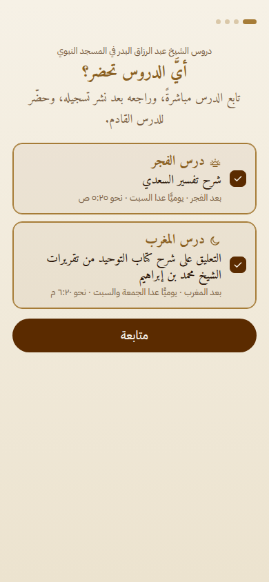
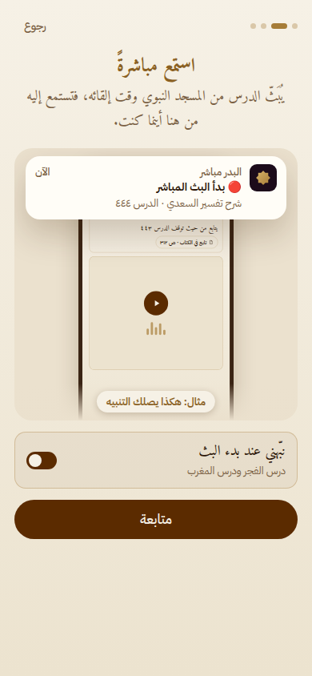
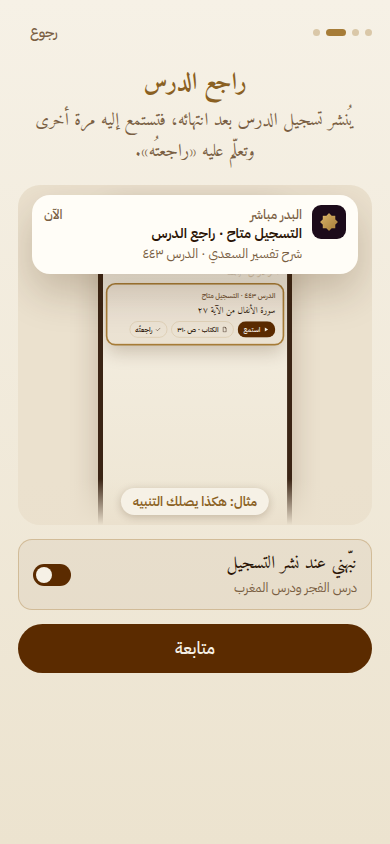
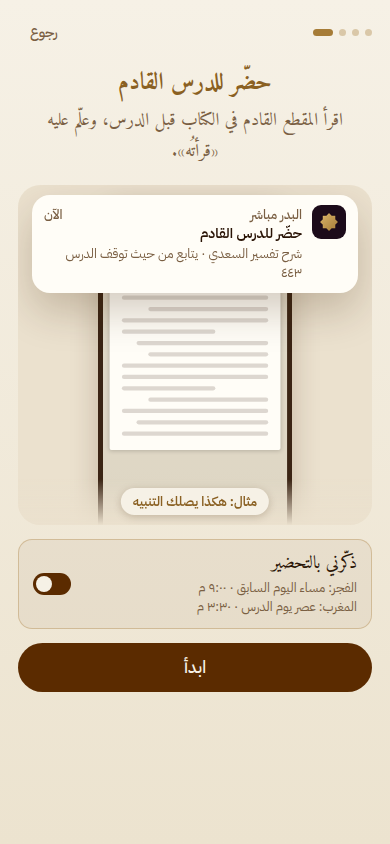

# Onboarding

The first launch explains what the app is for and lets the listener choose their notifications, in four screens built from the app's own components and the real `/api/state`. A redesign of the lesson screen or a new book changes the onboarding with no work on it.

| The app | Live | Revision | Preparation |
|---|---|---|---|
|  |  |  |  |

## The flow

```
[1 The app]  →  [2 Live]  →  (permission)  →  [3 Revision]  →  [4 Preparation]  →  lesson tab
 lessons as      preview:      only if the       preview:           preview:
 checkable       live player   switch is on      recording card     book at the
 cards           + one switch  and permission    + one switch       passage + one switch
                               is still "prompt"
```

- **Screen 1** names each lesson with its real title, days and time, as checkable cards. At least one must be ticked.
- **Steps 2–4** each show a **preview** of that notification (`ui/Preview.tsx`): a small phone (about 45% size) on a tinted panel, captioned «مثال: هكذا يصلك التنبيه», showing the lesson page of the first ticked lesson that has the data. It plays by itself:
  1. the notification slides down from the phone's status bar, with the server's own wording (`NOTICE_TITLE`, `lessonNoticeBody`, `prepNoticeBody` in `shared/src/notices.ts`, used by the server's jobs too);
  2. it grows out of the phone, centred at the top of the panel, so it can be read, and the app behind it dims;
  3. a ghost-finger ring taps it where it stands, and it goes back into the status bar;
  4. the phone opens what a tap on the real notification opens, as decided by the app's own routing (`routeForPush`, and `liveIntentAction` for live): **live** opens the live player over the lesson (`LiveHead` from `LiveSheet`, with Mixlr's player drawn, never loaded); **revision** scrolls the lesson page to the recording card, highlights it, and a ghost tap ticks «راجعتُه»; **preparation** opens the book at the next passage with its «بداية الدرس تقريبًا» marker (`BookBar`, `BookFoot` from `Book`, the page drawn, the PDF never downloaded; «قرأتُه» is left out, as the small phone does not reach it), or, when the course has no book, the lesson page with the next lesson's card highlighted and nothing ticked.

  Each step starts its own picture. It plays twice, then rests on one still frame: the notification above what it opened. With reduced motion it shows only that frame, and nothing in it moves or pulses. The live hero's big red play button never appears, so nothing in the picture looks like it can be tapped now. Nothing in the picture reacts: `inert`, `aria-hidden` and `pointer-events: none`, plus a capture-phase click handler; one visually hidden sentence outside it tells screen readers what it shows. The panel takes the height left over (180 to 340 px), so the switch and the continue button stay on screen down to 320×568.
- Under the picture, in its own block (so the picture can be replaced without touching it), **one switch** for that notification, applied to every lesson ticked on screen 1. Its hint names those lessons; on the preparation step it gives each one's reminder time, one per line. Everything starts on.
  - **Other broadcasts** (`live-other`) have no switch of their own: they follow the live switch, on with it and off with it, even when only Fajr is ticked, since they are rare.
  - The switch reads on when any ticked lesson has that notification on («بث مباشر آخر» counts only when no lesson is listed: then the live switch is its switch, and revision and preparation show none). Left untouched, the record is saved as it came in, so a replay keeps the per-lesson detail set in التنبيهات; a tap sets every ticked lesson (and, on the live step, other broadcasts) to the new value.
  - The التنبيهات screen in المزيد keeps one switch per lesson and notification, plus its own «بث مباشر آخر»; the stored record stays per lesson.
- **Permission** is asked when the listener continues from the first step whose switch is on, and only while it is still `prompt`. Refused: the switches stay, with a line saying they will work once enabled.
- **Web:** the same screens without switches or permission.
- Choices and the `onboarded` flag are saved only on the last step; leaving mid-way starts again next launch. Everyone sees it once, existing users included, starting from their own choices; when the flag or the preference record can't be read, it is shown again. A tapped notification goes first: the onboarding waits for the next launch. «كيف يعمل التطبيق» in المزيد replays it; leaving from its first screen saves nothing, and a tapped notification closes it, replacing it in history, so back does not reopen it.

The decisions live in `app/src/logic/onboarding.ts` (steps, which card, what each step's switch controls and reads, when to ask, the record written at the end) and `app/src/logic/preview.ts` (where each notification leads, the beats and their timing, the still frame, the phone's scale and scroll).

## One record of what the listener wants

Both lesson tabs are always shown. The only stored preference is `prefs` (`app/src/logic/prefs.ts`):

- `wanted`: the topics the listener chose, kept for a course that left the list, so a pause brings it back as it was. Only listed courses are subscribed; `topics` keeps what FCM accepted, so a failure is retried on the next sync.
- `known`: every course seen, with its slot, in the order it appeared.
- **A new book** inherits the switches of the last known course of its slot, even one that already left, so a gap between two books carries the choice over. A course in a slot with no history starts with every notification on, so finishing the onboarding while no lesson is listed still leaves the first lessons notifying. A slot whose lesson was left unticked stays silent: that lesson is known, with every switch off.
- **The tab the app opens on:** the soonest lesson with a switch on (all lessons when none), unless a broadcast is on air.

### Migration from the follow record

Older versions kept a `follow` record (which lessons are shown) and their subscribed `topics`. At the first launch of this version, once the course list is known:

1. `known` comes from the follow record in the order it saw courses; `wanted` from the stored topics (or all three kinds of the followed lessons when no topics were stored).
2. Courses the old record never saw go through the same inheritance as a new book.
3. Installs from before the lesson choice (topics only) keep their old default: all three kinds for a course they had not seen.

`follow` and `topic-courses` are removed once `prefs` is saved.
